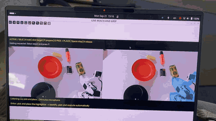
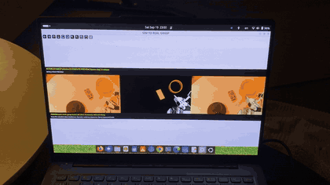

# SO-101 MuJoCo Mirror: Voice-Driven Pick-and-Place

| GPT-selected pick-and-place (real arm) | Plan in MuJoCo, then execute on the real arm |
|---|---|
| [](media/gpt-pick-and-place.mp4) | [](media/sim-to-real-grasp.mp4) |
| The command names an object. GPT picks the matching outline from the overhead camera, then the arm grasps it and places it on the red plate. | The grasp, lift and placement are previewed in MuJoCo first (left of screen), then run on the physical arm onto the yellow plate. |

The GIFs play at 3× speed. Click either one for the full-length MP4 ([video 1](media/gpt-pick-and-place.mp4), [video 2](media/sim-to-real-grasp.mp4)).

**A desktop SO-101 robot arm paired with a calibrated MuJoCo copy of itself. Cameras update the virtual desk, motions are planned and previewed in simulation, and the same plan then runs on the real arm. You can type or say "pick and place the biscuit": GPT chooses which object on the table you mean, and the local planner and motor controller do the rest.**

## Highlights

- **Digital twin of a real desk.** The SO-101 MJCF model sits on a measured virtual table with two cameras. Encoder feedback drives the virtual arm live, and calibrated joint offsets keep the two in step.
- **Camera calibration and registration.** Checkerboard intrinsics give 0.287 px RMS over 27 views. ArUco markers and table-plane fits register the overhead camera to the robot base. A wrist-camera calibration that failed held-out validation was documented and deliberately not used.
- **Vision without a trained detector.** OpenCV image differencing against a saved baseline finds new or moved objects. Contours are projected onto the calibrated table plane to give each object's metric size and orientation, and the plate is re-detected before every plan.
- **Inverse kinematics with SciPy and MuJoCo.** Bounded `least_squares` proposes joint angles, and MuJoCo forward kinematics scores each one for position, jaw orientation, joint limits and table clearance. `brentq` solves for the gripper angle that gives the required jaw gap.
- **Language as the interface, with geometry in control.** Speech goes through `gpt-4o-mini-transcribe`. The overhead image, with numbered contours drawn on it, goes to `gpt-4.1-mini`, which returns structured JSON naming one candidate. GPT never sends joint angles or motor commands. Planning, IK and control all run locally.
- **Supervised real-arm execution.** A separate worker process owns the LeRobot motor bus and streams interpolated segments with endpoint checks, a heartbeat watchdog, pause tokens, Space to stop and X to release torque. Adaptive modes pause and replan when the target moves.
- **183 hardware-free tests.** They cover trajectory limits, controller faults, recognition edge cases, plate occlusion, voice parsing and MuJoCo contact fixtures.

Four reports written during the project are in [`reports/`](reports/):

| Report | Contents |
|---|---|
| [SOARM_MuJoCoMirror_Thesis_Report.pdf](reports/soarm_thesis/SOARM_MuJoCoMirror_Thesis_Report.pdf) | 28-page engineering report covering calibration, registration, vision, IK, trajectories, contact simulation, evidence and limitations |
| [Voice_to_Pick_and_Place_Pipeline.pdf](reports/voice_pick_place/Voice_to_Pick_and_Place_Pipeline.pdf) | Every step from microphone to motors, including what is sent to OpenAI and what stays local |
| [IK_Explained.pdf](reports/ik_explained/IK_Explained.pdf) | How the SciPy–MuJoCo inverse-kinematics loop works in this setup |
| [Setup_Tools_Explained.pdf](reports/setup_explained/Setup_Tools_Explained.pdf) | Plain-language guide to each tool: MJCF, calibration, fiducials, contours, FK/IK |

## Pipeline

```text
"Pick and place the biscuit"  (voice → OpenAI transcription, or typed)
              ↓
Overhead camera → undistort → baseline differencing → contours (OpenCV)
              ↓  numbered outlines + object name
GPT vision → {"status": "selected", "candidate_id": 2}   (identity only)
              ↓
Contour → calibrated table plane → robot base frame → size and orientation
Plate re-detected (feature match, colour/ellipse fallback)
              ↓
IK: SciPy least_squares ⇄ MuJoCo mj_forward, plus clearance checks
open → hover → descend → close → lift → over plate → release → return to sitting
              ↓
control_worker.py → LeRobot bus → Goal_Position, with Present_Position feedback
```

## Run

There are two Python environments. The project environment runs the simulation, vision and planning. A separate [LeRobot](https://github.com/huggingface/lerobot) environment owns the motor bus.

```sh
python -m venv .venv && .venv/bin/pip install -r requirements.txt

# Simulation only (no hardware)
.venv/bin/python src/simulate.py
MUJOCO_GL=egl .venv/bin/python src/simulate.py --headless --seconds 5 --render scene.png

# Tests (no hardware)
MUJOCO_GL=egl PYTHONPATH=src .venv/bin/python -m unittest discover -s src/tests
```

To drive the real arm, set `LEROBOT_PYTHON` to the interpreter of your LeRobot environment and `SOARM_PORT` to the arm's serial device. Set `OPENAI_API_KEY` for GPT selection and voice commands.

```sh
export LEROBOT_PYTHON=~/miniforge3/envs/lerobot/bin/python
export SOARM_PORT=/dev/serial/by-id/usb-…
.venv/bin/python src/adaptive_grip.py --gpt-fixed-place --voice   # say or type "pick and place the biscuit"; Space stops, X releases torque
```

The calibration files in `config/` and `calibration/` describe one specific desk, camera mounting and arm. On a different setup the cameras, table plane and joint offsets must be calibrated again. See [`docs/DEVELOPMENT_LOG.md`](docs/DEVELOPMENT_LOG.md) for the full step-by-step history.

Run commands from the repository root. Report builders are `src/build_thesis_report.py`,
`src/build_voice_report.py`, `src/build_ik_explainer.py`, and `src/build_setup_explainer.py`.

## Repository layout

```text
src/                All Python code: application, calibration, verification and report builders
src/tests/          Hardware-free test suite and fixtures
src/archive/        Historical code backups (local only)
scene.xml           Generated MuJoCo scene (rebuilt from config/scene.json by src/build_scene.py)
assets/so101/       SO-101 MJCF model and meshes (Apache-2.0, from MuJoCo Menagerie)
config/             Scene dimensions, cameras, joint mapping, plate reference, measured objects
calibration/        Camera intrinsics, registrations, joint offsets and saved preflight results (JSON)
captures/           Small saved planning results and the reference images the code and tests use
docs/               Mode guides (adaptive reach, GPT reach, live grip, named reach, wrist tracking) and the development log
reports/            The four PDF reports and their supporting assets
media/              Demo videos and GIF previews
```

| Mode | Command | Guide |
|---|---|---|
| GPT and voice pick-and-place | `src/adaptive_grip.py --gpt-fixed-place --voice` | [GPT_REACH.md](docs/GPT_REACH.md) |
| GPT reach, grip or place only | `--gpt-reach`, `--gpt-grip`, `--gpt-place` | [GPT_REACH.md](docs/GPT_REACH.md) |
| Live reach and grip | `src/adaptive_grip.py` | [LIVE_GRIP.md](docs/LIVE_GRIP.md) |
| Taught object names | `src/adaptive_grip.py --named-reach` | [NAMED_REACH.md](docs/NAMED_REACH.md) |
| Adaptive replanning | `src/mirror_grasp.py --adaptive` | [ADAPTIVE_REACH.md](docs/ADAPTIVE_REACH.md) |
| Wrist-camera commissioning | `src/adaptive_grip.py --wrist-setup` | [WRIST_LOCAL.md](docs/WRIST_LOCAL.md) |

**Stack:** Python, MuJoCo, OpenCV, NumPy, SciPy, LeRobot, the OpenAI API (transcription and vision) and ReportLab.

## Limitations

This is a supervised prototype. Physical reaching, grasping and placing have been demonstrated, as the videos show, but no repeatable success rate or millimetre accuracy has been measured. The overhead-to-base registration is provisional. Object heights come from configuration rather than depth sensing, and the plan stays fixed once the arm begins moving. MuJoCo checks geometry and kinematics, but it does not model grasp force or packet deformation. The reports set out these limits in detail.

`src/build_voice_report.py` expects Arial TTF files in `reports/voice_pick_place/fonts/`. These are not included because of their licence.

## Contributors

[sesasa](https://github.com/sesasa) developed the project. Claude Code assisted with review.

## License

MIT for this project's code. The SO-101 model in `assets/so101/` keeps its original Apache-2.0 licence.
