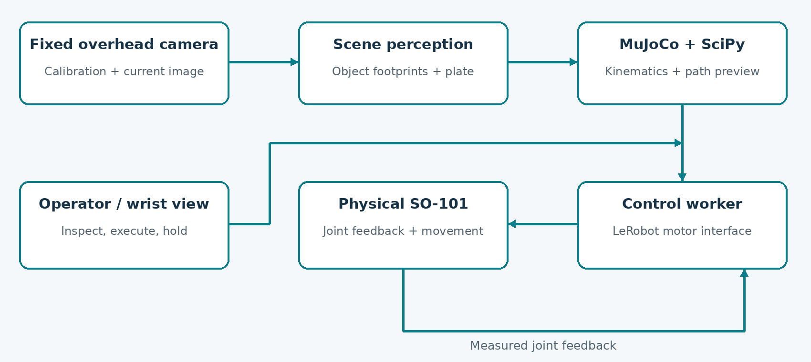
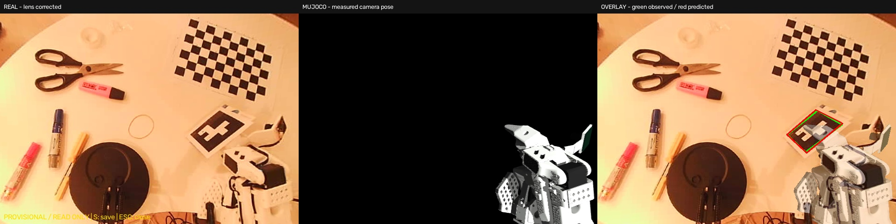
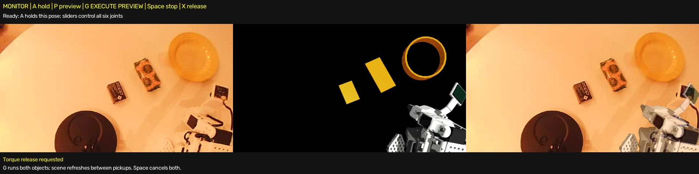
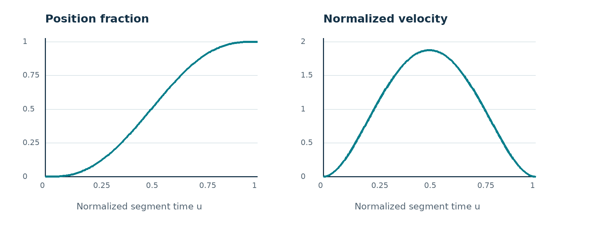
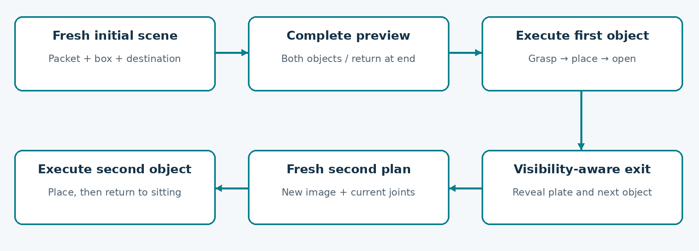
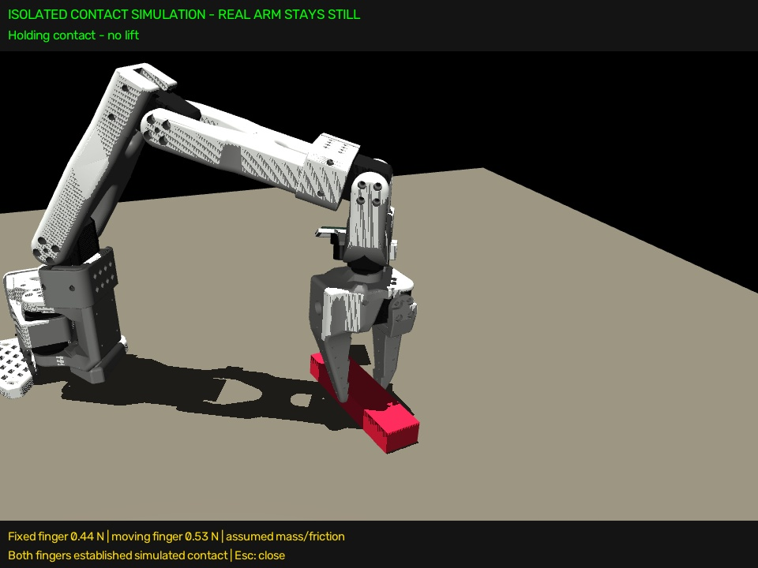

# Abstract

This project developed a camera-informed MuJoCo representation of a desktop SO-101 manipulator and a simulation-mediated interface for commanding the physical robot. The initial objective was practical: reproduce the desk, arm and cameras well enough to preview movement, move six controls in simulation, and subsequently reach for and place real objects. The work progressed from manually measured scene geometry and read-only joint mirroring to camera calibration, inverse kinematics, grasp trajectories, destination tracking and a two-object pick-and-place sequence.

The system combines an existing SO-101 MJCF model with measured joint feedback, a fixed overhead camera and a wrist camera. OpenCV supplies checkerboard calibration, fiducial detection, image differencing, contour geometry and destination matching. MuJoCo supplies geometry, forward kinematics, rendering and separate contact experiments. SciPy supplies bounded nonlinear optimization and scalar root finding. LeRobot supplies the SO-101 motor interface and calibration conventions. The original perception and planning path used classical computer vision and numerical optimization. The new optional GPT mode adds a pretrained vision-language model for object identity; live localization, IK and motor control remain geometric and feedback-based. No learned motion policy or reinforcement-learning policy is used. Section 17 documents the adaptive tracking and GPT grasp extensions.

The overhead intrinsic calibration achieved a recorded reprojection RMS of 0.287 pixels over 27 rigid-board views. The overhead-to-base registration remained provisional, and wrist optical registration failed held-out validation and was not adopted. These distinctions matter: a visually convincing overlay and low intrinsic reprojection error do not establish millimetre-accurate physical grasping. Practical alignment therefore included explicitly recorded joint offsets, a camera-left reach correction and user-adjusted descent and jaw-gap settings.

The user confirmed successful physical reaching, grasping and placing during development. Separate MuJoCo fixtures demonstrated contact, lifting and release under assumed physical parameters. The latest two-object changes were checked in software and saved-scene planning; a repeatable physical success rate for the final complete batch has not been established. The contribution is a working supervised manipulation prototype, its reproducible engineering pipeline, and a documented account of where calibration, observability and execution differ from an ideal digital twin.

This report is a thesis-style engineering account, not a claim of a completed academic thesis or a certified robot system. It documents the repository and saved evidence inspected on 20 September 2026.

# 1. Motivation, objectives and scope

## 1.1 Why build a simulation counterpart?

Directly moving a robot toward an object gives little opportunity to inspect the intended path. A simulation counterpart makes the desired motion visible before execution and provides a shared coordinate system for camera observations, object estimates and joint commands. The intended workflow was therefore: observe the desk, update the virtual scene, produce a trajectory in simulation, inspect it, then send the corresponding commands to the arm.

The user initially supplied desk photographs and the dimensions of a controller, 22 by 5 cm. This was enough to begin an approximate model, but not enough to determine every camera parameter, link alignment or object height. Subsequent ruler photographs, temporary 15 cm table markings, printed calibration patterns and encoder observations progressively replaced visual estimates with metric constraints. The blue markings were later erased and explicitly retired as active references.

The practical questions were whether measured joints could drive a consistent virtual arm, whether inverse mapping could command a useful physical reach, whether video could update moved objects and the destination, and whether a second grasp could follow the first without returning to the sitting pose.

## 1.2 What “digital twin” means here

The implemented counterpart has three distinct capabilities. It displays robot geometry at measured joint positions; it updates approximate object and destination geometry from an overhead image; and it previews planned joint motion. Separate contact experiments use MuJoCo dynamics. The normal real-arm planning path primarily uses kinematics and sampled geometry checks, rather than predicting the full physical dynamics of every grasp.

The table is represented by a calibrated plane. Objects are represented by simple footprints and height assumptions, rather than photorealistic three-dimensional reconstructions. The wrist camera supplies an additional operator view; its unaccepted extrinsic calibration prevents it from serving as a trusted second metric viewpoint. Consequently, this is not a calibrated stereo reconstruction system.

## 1.3 Evidence and reporting conventions

“Measured” identifies a recorded calibration value, encoder observation or user dimension. “Simulated” identifies a model result. “User-confirmed” identifies qualitative physical feedback during development. “Implemented” identifies behavior present in source code, without implying demonstrated physical reliability. “Provisional” marks assumptions or calibrations that were not fully validated.

These labels prevent three common confusions: a successful preview is not a completed physical execution; a position command is not a measured gripping force; and a pixel residual is not a direct measurement of tool-tip accuracy. Historical README entries describe earlier states, so current source and configuration take precedence where the history contains superseded settings. [E1–E9]

# 2. Hardware and software architecture

## 2.1 Physical arrangement and camera roles

The platform consists of an SO-101 arm with five arm joints and one gripper actuator, a USB serial connection, a fixed overhead camera and a camera mounted near the wrist. The six interface controls correspond to these six actuators; they do not constitute six independent Cartesian pose degrees of freedom.

Camera roles changed during setup as the wider view was assigned overhead. Stable device identities are therefore more meaningful than transient camera numbers. The final recorded overhead device ends in `202404160005-video-index0` and uses MJPG at 640 by 480 pixels. The wrist device ends in `icspring_camera-video-index0` and uses YUYV at the same resolution. The recorded wrist capability probe exposed no zoom control and only the delivered 640 by 480 mode. Digital zoom-out cannot recover an unobserved field of view.

Closing the curtains, changing camera position and tilting the wrist lens improved usable image content. These steps had a direct purpose: reduce saturation, keep the work area visible and expose the fingertip gap. Software calibration cannot recover texture destroyed by overexposure or see through the gripper holder.

## 2.2 Division of responsibilities

The simulation and vision code runs in the project Python environment. A separate LeRobot environment owns the physical motor connection through `control_worker.py`. Keeping one process responsible for bus access avoids competing commands and inconsistent torque state. Structured commands and feedback connect the user interface to that worker.

The interface can show the camera image, virtual arm and an overlay. Measured joint feedback drives the actual-pose visualization. A proposed trajectory drives a separate preview. This distinction is essential when the model reaches a target but the physical sequence stops or never starts its next stage.

## 2.3 Libraries actually used

| Component | Role in this project | Inspected version or source |
| Python | Application logic, process coordination and saved evidence | Project interpreter; see manifest |
| MuJoCo | MJCF loading, forward kinematics, rendering, contact fixtures | 3.13.0 |
| OpenCV | Video acquisition, calibration, contours, features and image matching | opencv-python 5.0.0.93 |
| NumPy | Joint vectors, transformations and image/mesh arithmetic | 2.5.3 |
| SciPy | Nonlinear least squares, root solving and convex hulls | 1.18.1 |
| LeRobot | SO101Follower interface and motor calibration conventions | Separate local source/environment |
| GLFW / OpenGL | Viewer and rendering support | Versions archived in manifest |
| ReportLab / Pillow | This report and its figures | Documentation tools, not robot planning |

MuJoCo's model/data separation and Python bindings support the geometric computations used here [R1]. LeRobot's SO-101 support provides the hardware integration foundation [R4]. Package availability does not imply that every capability of those packages is active.

# 3. Constructing the virtual desk and arm

## 3.1 Reuse the mechanical model; measure the environment

Rebuilding the robot from photographs would duplicate established mechanical geometry while introducing uncertainty in joint axes and link dimensions. The project instead reused the SO-101 MJCF asset from the local MuJoCo Menagerie copy. The asset README traces its derivation to The Robot Studio model and preserves the Apache-2.0 license. The original robot assets remain available under `assets/so101/`.

`build_scene.py` constructs the working scene around that model. The initial desk, camera housing and object placements were approximate, guided by photographs and known dimensions. `align_scene.py` supports rough image alignment. These estimates were useful for getting a recognizable environment quickly; later camera and table calibration supplied a better basis for metric localization.

The user's ruler photographs and controller dimensions constrain visible lengths, not hidden surfaces or lens distortion. A length in the image can only become a reliable table distance once perspective and scale are accounted for. The project therefore moved from an illustrative desk model to calibrated planar geometry instead of treating the first reconstruction as metrically complete.

## 3.2 Visual geometry and optical geometry are different

The wrist-camera holder initially disagreed with the physical holder. The user supplied `IMG_8804.heic`, requested an approximately 25-degree clockwise visual rotation and then a shift toward the gripper. The saved registration notes record a final 15 mm shift along the holder's rotated local negative Z direction. `wrist_mount_visual.py` contains the visual construction.

These changes improve interpretation of the overlay. They do not, by themselves, calibrate the camera's optical centre or establish exact collision geometry. The holder appearance, optical mounting transform and clearance approximation are separate quantities. This distinction answers the user's earlier question about whether an exact-looking holder is essential: visual detail helps inspection, but reliable optical registration and conservative geometric assumptions matter more for positioning.

## 3.3 Model fidelity needed for this task

The chosen abstraction keeps the robot mechanism detailed enough for joint and fingertip calculations while representing tabletop items with inexpensive geometric proxies. It supports previewing reach and placement without requiring dense scene reconstruction. Its limits are correspondingly explicit: flexible packets, cable motion, compliance, friction changes and hidden object surfaces are not reconstructed from the overhead image. [E1, E3]

# 4. Motor calibration and joint correspondence

## 4.1 Why calibration preceded commanding

A motor encoder reports a position in the device's convention. MuJoCo expects a joint coordinate in the model's convention. Before a simulated pose can be sent to hardware, the project must establish direction, reference offset and usable range, and must distinguish gripper opening from arm-joint angle.

The hardware was initially uncalibrated. A read-only probe reached all six motors, with torque off. The user placed the arm approximately at the midpoint of its travel and manually swept the requested joints. The resulting motor calibration was saved in `calibration/soarm_mirror.json`; recorded span checks reside in `calibration/validation.json`. LeRobot's wrist-roll full-turn convention is not a measured guarantee of cable clearance.

`robot_setup.make_robot()` constructs the SO101Follower with degree-based joint feedback. Read-only probing connects to the bus without implicitly enabling torque. `mirror_robot.py` then maps measured positions into the virtual arm. The user confirmed all six directions before progressively testing commands.

## 4.2 Mapping and visual corrections

For the five arm joints, the conceptual mapping is q_sim = sign × radians(q_motor) + offset. Its inverse removes the offset and applies the inverse unit and sign conversion. `command_mapping.Mapping` also intersects model limits with calibrated motor ranges. The gripper uses a separate mapping from normalized feedback to an estimated hinge-angle interval.

| Joint | Recorded sign | Final simulation offset | Basis |
| Shoulder pan | +1 | 0 degrees | Direction confirmed; no added visual offset |
| Shoulder lift | +1 | 0 degrees | Direction confirmed; no added visual offset |
| Elbow flex | +1 | −5.5 degrees | Successive user-guided upward corrections |
| Wrist flex | +1 | −4.5 degrees | Successive user-guided upward corrections |
| Wrist roll | +1 | −90 degrees | Align camera-on-top gripper orientation |

The gripper interval is approximately −0.174533 to 1.745329 radians. The offsets correct the feedback-to-model relationship; they are not additional changes to motor homing. The user accepted the overall appearance after comparing a midrange photograph and the simulated arm. Full-range metrological accuracy remains unverified, as reflected in the mapping metadata.

## 4.3 Gripper gap and the sitting pose

The user compared approximately 33–34 mm at the fingertip steps and a 50 mm opening with the requested model gap. This supported a useful practical correspondence, but not a calibrated force law. `fingertip_gap()` and scalar root finding choose a hinge angle for a desired geometric gap.

A recorded sitting pose later made startup and return more convenient. The commandable return goal is distinct from a torque-off resting observation near a joint endpoint. This avoids assuming that every passive resting pose lies inside the normal working range. [E2, E6]

# 5. Camera intrinsics and printed-target scale

## 5.1 Why many tilted images were needed

The intrinsic calibration estimates focal lengths, principal point and lens distortion. A single flat image provides weak information about several of these parameters. Moving and tilting a rigid target produces different perspective constraints, allowing the solver to separate camera properties from board pose. Merely collecting many nearly identical images would not provide the same information.

`make_calibration_board.py` generated large and small checkerboard PDFs. The nominal 100 mm scale bar printed as 96 mm. The capture code therefore used a scale factor of 0.96: nominal 25 mm squares became 24 mm, and nominal 10 mm squares became 9.6 mm. Using the nominal dimensions would have biased metric translations and distances. The saved scale correction assumes uniform printing scale in both directions.

The earlier flexible-paper captures were retained as history but rejected for the reviewed overhead result. A rigid backing reduces departures from the planar checkerboard model. During intrinsic collection the board may move between saved views; this is intentional. For table-plane registration, however, a tilted board does not represent the tabletop. These are different experiments with different placement requirements.

## 5.2 Implementation and validation

`camera_calibration.detect()` uses `cv2.findChessboardCornersSB()` for a 9 by 6 inner-corner pattern. `object_points()` creates 54 metric planar coordinates. `fit_views()` calls `cv2.calibrateCamera()` and `cv2.projectPoints()` to estimate parameters and reprojection error. The capture loop saves raw frames and corners, rejects near-duplicate views and records the camera identity, image size and print scale.

The solver withholds every fifth view for a check: training views estimate intrinsics, while `cv2.solvePnP()` estimates only the held-out board pose. Reprojecting the withheld corners tests how the fitted camera transfers to unseen views. A later all-view fit produces the stored candidate. OpenCV documents these projection and calibration functions [R2].

| Calibration quantity | Overhead | Wrist |
| Reviewed views | 27 | 37 |
| Actual checker square | 24 mm | 9.6 mm |
| Stored RMS reprojection error | 0.287 px | 0.711 px |
| Held-out error range | 0.173–0.374 px | 0.437–0.792 px |
| Stored focal lengths fx, fy | 407.37, 411.18 px | 1288.33, 1289.90 px |
| Model/status | Five distortion coefficients; limited coverage | Radial-only provisional fit |

Overhead corners covered approximately x=126–526 and y=52–285 in a 640 by 480 image. Bottom and outer-region accuracy was not independently validated. Wrist subset estimates showed principal-point variation of about 31 pixels horizontally and 16 vertically, despite relatively stable focal estimates. These figures justify retaining uncertainty rather than interpreting low training error as complete calibration. [E3]

# 6. Registering table, robot base and cameras

## 6.1 The coordinate problem

Camera calibration alone does not tell the robot where an object is. A detected pixel must be related to a table location, and that location must be expressed in robot-base coordinates. We use T_A_B to mean a rigid transform that maps coordinates from frame B into frame A. The main frames are camera C, robot base B, gripper G and a temporary marker M.

For undistorted points on a known planar board, the project uses the homography H = K [r1 r2 t]. Applying its inverse maps image pixels to coordinates on that plane. `scene_changes.Plane.board_xy()` uses `cv2.perspectiveTransform()`, while `footprint()` fits a metric rectangle. The board-to-base relationship then expresses the result in the robot's coordinate system.

`register_table_plane.register()` used a checkerboard directly on the tabletop. The recorded plane fit had 0.343 px RMS and a perpendicular camera distance of 0.42217 m. A subsequent board placement gave 0.278 px RMS, a 0.42406 m distance and a 0.056-degree normal difference. The 1.88 mm height difference is useful consistency evidence, but changing board position also changes its XY origin; the board coordinates cannot simply be mixed.

## 6.2 Why the marker experiment replaced a weak base fit

The first base registration used three manually selected CAD base-plate landmarks. Its 3.78 px image fit did not align the entire moving arm sufficiently, so it was not accepted as the physical command transform. Multiple poses exposed that a plausible local base fit could still produce incorrect link alignment.

A printed ArUco marker was then temporarily attached to the fixed part of the gripper assembly. `capture_marker_registration.py` detected its corners with `cv2.aruco.ArucoDetector` and saved stationary joint observations. A rigid attachment mattered because the solver assumed one constant marker-to-gripper transform across poses. The paper needed to remain stable without preventing jaw motion or obscuring useful camera views.

`solve_marker_registration.fit_transforms()` jointly fits the camera-to-base and marker mounting relationships using SciPy `least_squares()` with a robust soft-L1 loss. Forward kinematics supplies T_B_G(q), giving the chain T_C_M = T_C_B T_B_G(q) T_G_M. Marker corner projections connect that chain to image measurements.

The saved 16-capture result reports 3.57 px raw-corner RMS and held-out errors of 2.05–7.27 px. Refining three bending-joint offsets did not improve pooled held-out results and was not selected. The resulting overhead/base transform supports the subsequent prototype, but remains explicitly provisional. [E3, E4]

# 7. Wrist registration: an informative unsuccessful experiment

## 7.1 Why a wrist optical transform was desirable

A calibrated wrist camera could relate a close-up fingertip observation to the same coordinates as the overhead view. That could eventually support fine visual corrections near a grasp, where the overhead camera may be occluded. A visual model of the camera holder is insufficient: the optical frame must be identified relative to the moving gripper.

The project captured paired checkerboard observations and robot poses to estimate a shared wrist optical mount. `capture_wrist_extrinsics.py`, `solve_wrist_extrinsics.py` and `solve_wrist_bundle.py` preserve the experiment. The setup required a sufficiently rigid board, a stable camera mount and diverse joint poses. The user found that maintaining visibility in the narrow wrist view constrained board motion, and later secured a slightly wobbling attachment.

## 7.2 Why the estimates were rejected

Six paired views were evaluated with fixed-board and jointly fitted board-pose variants. Leave-one-pose-out errors were approximately 13–58 px. The overhead board image itself was stable to within roughly 0.3 px, so simply assuming large board motion would not explain the result.

After securing the mount, another session collected ten captures in seven distinct pose groups, including wrist-roll variation. Group-held-out errors still ranged from 8.8 to 38.3 px with the overhead transform fixed. Allowing the overhead transform to change also failed validation and shifted it by about 45 mm. Neither candidate was promoted to a working calibration.

These observations identify an inconsistent calibration chain, but do not uniquely prove whether mount geometry, wrist intrinsics, synchronization, joint mapping or another assumption caused the inconsistency. The appropriate engineering response was to retain the evidence and avoid applying a poor transform. Further near-identical captures would not by themselves resolve a systematic modeling error.

## 7.3 Consequence for the final system

The operational metric scene interpretation relies on the overhead camera and provisional table/base registration. The wrist camera remains useful for viewing the gripper and nearby object, not for validated triangulation or automated wrist visual servoing. Reports of changing detection when fingers entered the image were observations to investigate, not evidence of a trained detector or successful optical calibration.

This is a substantive result rather than a missing detail: rejecting a transform that fails held-out checks prevents a superficially convincing two-camera demonstration from being described as accurate multi-view reconstruction. The rejected candidates and review remain in `calibration/robot_camera/`. [E4]

# 8. Updating objects and the destination from video

## 8.1 From image differences to table footprints

The user wanted moved and newly added objects to appear in the simulation. `scene_changes.Changes` compares the current overhead image with a baseline using blurred LAB-color features. It compensates for a global color shift, thresholds the remaining difference, applies morphological cleanup and requires persistence before treating changes as stable. Robot masking prevents much of the moving manipulator from being interpreted as a tabletop object.

Contours then become approximate metric footprints through the plane transform. `merge_contained_fragments()` and `refine_current_contours()` reduce fragmentation and overly broad outlines. This was important when shadows and pen outlines looked larger than the physical item. A footprint is still an estimate: thresholding and table-plane projection can bias dimensions, particularly for tall objects.

In the two-object mode, `batch_grasp.table_targets()` filters footprints by width, length and aspect ratio, excludes substantial overlap with the plate, and labels the longer candidate “packet” and the shorter candidate “box.” This is a task-specific size heuristic, not semantic object recognition. It expects one clearly separated candidate of each required kind.

## 8.2 Why the plate must be re-detected

The user moved objects and the destination between attempts. Reusing old coordinates could yield a valid path to the wrong place. `basket_tracking.measure_basket()` therefore obtains a current destination estimate for planning. The legacy name “basket” remains in code even after the white basket was replaced by a yellow plate with a 20 mm rim.

The destination locator combines feature matching against a saved reference, a yellow-plate detector and a template fallback. SIFT features and ratio-filtered matches support an affine RANSAC estimate when enough distributed evidence is visible. The color path uses HSV thresholds, contour geometry and ellipse consistency to handle a partly occupied plate. The fallback searches rotation and scale with normalized image matching, including texture and ambiguity checks. Failed localization is reported rather than silently substituting an old destination.

## 8.3 Limits of adaptability

The pipeline updates the known tabletop task without a learned model, but it is not arbitrary scene understanding. Lighting changes, merged contours, severe occlusion or several similarly sized items can make association ambiguous. Object heights are supplied as assumptions; they are not recovered reliably from this single overhead image. The project responds to changed observations by rebuilding plans, not by continuously reconstructing every surface during execution. [E5]

# 9. Inverse kinematics and grasp construction

## 9.1 Why joint mirroring was not enough

Matching a physical pose in simulation established a useful joint correspondence. Reaching a camera-measured object additionally requires choosing joint angles that put the jaws in the right position and orientation. This inverse-kinematics problem is constrained: five arm joints cannot generally satisfy an arbitrary six-dimensional tool pose.

`simulated_reach.ReachSolver.position()` evaluates forward kinematics with `mujoco.mj_forward()`. Position-only solving also uses `mujoco.mj_jacSite()` to obtain a site Jacobian. `solve_natural_grasp()` uses bounded SciPy `least_squares()` searches to balance position, downward orientation and jaw-axis alignment. Multiple seeds and both equivalent jaw-axis signs help expose alternative wrist-roll solutions. SciPy's solver is a numerical optimizer, not a learned policy [R3].

The user specifically noticed that the planner could choose an inconvenient roll direction although the opposite direction remained reachable. Searching both orientation branches addresses this because a jaw axis aligned with an elongated object can often be reversed without changing the basic pinch geometry.

## 9.2 Retarget a successful approach

`mirror_grasp_plan.build_sequence()` uses a saved successful reach reference and the current object location. This made it possible to preserve a useful grasp posture while translating to a moved target. The reference is updated after a real approach reaches its endpoint rather than after a preview alone.

The user observed a lateral discrepancy and requested first a 10 mm, then a 20 mm correction to camera-left. `reach_retarget.camera_left_offset()` interprets left in the overhead image and converts it into a metric table direction. The implementation subtracts any previously applied correction before applying the new one, preventing repeated planning from accumulating the offset.

Height changes are similarly relative to reference metadata. This matters because an object height adjustment should not grow each time a plan is generated. The current packet and box height assumption is 40 mm. These corrections improve this setup empirically; they are not a substitute for a complete recalibration or an independently measured accuracy result.

## 9.3 Descend, close, and represent the load

`grasp_tail.build_tail()` adds a local descent and jaw closure. The current configured descent is 25 mm. A root solve converts the requested fingertip gap to the model's gripper coordinate. The packet closes to 35 mm. For the second box, the latest request adds 10 mm of closure to its usual 4 mm width margin: gap = max(5 mm, estimated width − 4 mm − 10 mm). A 43 mm estimate therefore gives approximately 29 mm.

The closed-object model used during transfer is attached geometrically to the gripper for clearance calculations. It assumes retention. There is no physical force sensor, slip estimator or automatic proof that the object was grasped. [E6, E7]

# 10. Trajectories and physical control

## 10.1 Why trajectories replaced abrupt targets

Sending a distant joint target in one step makes the intended motion difficult to inspect and can produce abrupt movement. The project generates continuous joint trajectories using the quintic interpolation s(u) = 10u³ − 15u⁴ + 6u⁵, with q(u) = q_start + s(u)(q_goal − q_start), for 0 ≤ u ≤ 1. Velocity and acceleration are zero at the nominal endpoints. Its peak normalized slope is 1.875, which is used when choosing nominal durations.

`command_mapping.DirectSegment` validates endpoints and timing. `control_worker.Controller` owns the bus, reads feedback and sends commands. Arming initializes goals from fresh measured positions before enabling torque, avoiding a jump to an old target. The direct worker runs at approximately 30 Hz; feedback and diagnostics allow it to detect departures from the planned command stream.

## 10.2 Speed changes and their interpretation

The user progressively requested faster motion. The implemented reach uses a faster initial portion and a slower final portion, followed by stage-specific descent, closure and transfer multipliers. The current global sequence multiplier is 2.0. Thus the early reach uses a local factor of 4 and an overall factor of 8 relative to its nominal timing, while its final portion uses a local factor of 2 and an overall factor of 4.

A nominal quintic segment remains smooth at its endpoints, but a piecewise time multiplier can change effective velocity at an internal timing boundary. “Smoother” in user feedback should not be interpreted as a measured jerk bound.

## 10.3 State, interruption and settling

The interface starts in MONITOR. A enables holding, P produces a fresh preview and G starts the prepared execution. Space holds/cancels, and X releases torque. One worker serializes hardware access. Heartbeat loss of approximately 0.5 seconds causes a hold; releasing attempts torque disable and verifies motor state, with per-motor fallback when needed.

Endpoint completion depends on feedback, not merely the animation clock. `replay_settling.endpoint_settled()` uses stage-specific tolerances: transit stages can accept 4 degrees of arm error, while other stages use 3 degrees; jaw tolerances depend on opening or contact-related stages. A recorded 3.04-degree shoulder discrepancy motivated the transit distinction. The settling timeout uses five seconds of wall time, avoiding premature expiry when accelerated playback advances virtual time quickly.

The position controller preserves the established gripper goal during a hold. This helps retain an object, but does not regulate a known grip force. [E2, E6]

# 11. Clearance, placement and return

## 11.1 Why reachability is only one condition

An inverse-kinematics solution can place a fingertip near the target while another part of the robot approaches the table. The project therefore samples intermediate poses and checks moving geometry against a table plane. `TableClearance` evaluates mesh support distances; `BasketClearance` adds destination and carried-object reasoning. Common plans record 161 sampled poses.

These checks explain some “plan refused” events that appeared surprising when the object looked reachable. A refusal may reflect the assumed holder geometry, provisional registration or another part of the arm, rather than the fingertip target alone. Inspecting the reported minimum and failing stage is more informative than assuming every refusal proves that the object is outside reach.

Sampled clearance is not continuous collision proof. The plan metadata explicitly states that table objects, cables and self-collision are not fully checked. Registration uncertainty and approximate geometry remain material. This report retains those limitations rather than labeling a passing path “collision validated.”

## 11.2 Placement in the updated destination

`basket_place.append_basket()` creates lifting, transfer and opening stages. It fits the carried object's footprint into the measured inner destination polygon, allowing a small offset from the centre when necessary. This is more useful than insisting on an exact central tool pose that the five-joint arm may not reach comfortably.

The physical destination changed from a 40 mm basket to a 20 mm yellow plate. Current physical, measurement and planning rim-height fields are all 20 mm. During second-object placement, a 40 mm occupied-height allowance accounts conservatively for the first object already in the plate. It is an occupancy proxy, not a reconstruction of the first object's final pose.

The opening target adds 15 mm to the estimated object width, capped at 75 mm. After the final placement, `sitting_return.build_sitting_return()` generates a checked path toward the stored commandable sitting pose. Reaching that pose does not automatically turn torque off.

## 11.3 Visibility is part of useful planning

After the first placement, a purely geometric retreat can leave the arm blocking the plate and second object. `camera_visibility.CameraVisibility` projects robot geometry into the overhead image and estimates how much of the relevant target area is covered. The plate-exit search evaluates alternative base rotations so that the next observation is usable.

This extends planning beyond “can the arm reach?” to “can the system see what it needs for its next decision?” It was directly relevant to the observed discrepancy between a successful two-object preview and a physical sequence that stopped after the first object. [E6–E8]

# 12. Two-object sequencing and fresh replanning

## 12.1 Desired behavior

The user requested two objects to be deposited one after the other, without a return to sitting between them. The system must therefore keep the first grasp's completion, destination occupancy and second object's current location consistent. A static animation of both grasps is useful for preview, but cannot ensure those assumptions remain true after a real placement.

`batch_grasp.prepare_batch()` builds both legs for the preview. Initial execution contains only the first object's stages and the plate-exit maneuver. After the first placement and exit, the application waits briefly, captures a new scene, remeasures the plate and remaining box, and generates the second execution plan from current state. The final sitting return belongs only to the second leg.

## 12.2 What prevented the second real reach

Several different issues appeared during development. An earlier preview omitted the second leg, which was a display/composition defect. A later complete preview did not guarantee physical continuation: endpoint settling, actual camera visibility and fresh scene detection still had to succeed.

The implemented visibility-aware exit specifically addresses the case where the arm obscures the destination after placement. The application also retries fresh-frame detection up to three times, holding between attempts. Failed frames and state are preserved for diagnosis. These retries cannot make a persistently hidden plate observable, which is why the exit pose matters.

Before selecting the remaining box, the batch code checks whether the already-completed object still appears outside the plate. This provides a coarse consistency check, not a reliable grasp-success classifier. Objects that overlap or look similar can still defeat this heuristic.

## 12.3 Cancellation and the latest change

One execution request authorizes the planned batch, but Space or X cancels its continuation. Job identifiers prevent late results from a cancelled planner from starting a stale trajectory. These details matter when planning is asynchronous and a user interrupts a long attempt.

The latest requested modification closes the second object's jaws another 10 mm. It is applied both when constructing the full preview and when constructing the fresh second leg. The corresponding unit test checks a 43 mm box estimate produces a 29 mm closing gap. A saved-scene second-leg plan completed after the change; physical reliability of the final complete batch is still an open validation item. [E7, E8]

# 13. Contact simulation and physical experiments

## 13.1 Why run a separate contact fixture?

Kinematic closure only places the fingers. It does not establish whether contact would support an object. `contact_preview.py` therefore provides a separate, hardware-free MuJoCo experiment with a free rigid highlighter proxy. It does not connect to cameras or the motor worker. Unlike the carried-box approximation in the live planner, this fixture does not weld the object to the gripper.

The object used the user's 27 mm width and 17 mm height. Mass of 30 g, friction coefficient 0.6 and simplified jaw actuator settings were assumptions. Contact was accepted only after both fingers sustained more than 0.02 N for 0.25 seconds. This tested the contact logic within one model configuration, not actual force calibration.

## 13.2 Saved model outcomes

The initial fixture established bilateral contact and then held. A later 20 mm commanded lift required maintained finger contact, object clearance and negligible table support. The saved lift result records a passed airborne hold, approximately 16.7 mm final object/table clearance, and zero final table force. The difference between commanded tool rise and object clearance reflects geometry and movement within the grasp.

The full cycle added set-down, release and withdrawal. Opening was gated on stable table support; withdrawal waited for finger contact to disappear. The recorded cycle completed in approximately 27.5 simulated seconds, leaving the object supported by the table with about 8.4 mm displacement from its initial location. These are single-fixture results with assumed parameters, not a robustness distribution.

## 13.3 Physical observations and their limits

The user confirmed that all six actuators responded, the virtual arm matched observed motion, a reach got close to the highlighter, subsequent grasp adjustments worked, and later placement worked. These confirmations are useful development evidence. The sequence also revealed missed descents, insufficient closure, stale target positions, awkward wrist-roll choices and failures to continue toward the second object.

There was no standardized trial set, independently measured endpoint ground truth or systematic record of success/failure over repeated object placements. Accordingly, this report does not assign a physical success percentage, millimetre-level accuracy or a validated payload capacity. The latest two-object path is implemented and tested against saved scenes, while its final physical repeatability remains unquantified. [E9]

# 14. Planning performance and verification

## 14.1 Why optimization became necessary

An interactive task loses usefulness if a new plan takes several minutes. The user reported a planning attempt running for more than five minutes. Profiling and inspection identified repeated mesh work in geometric checks as an avoidable cost. Making the planner faster required changing computation reuse rather than merely removing clearance checks.

`mesh_support.mesh_hulls()` caches each mesh's convex-hull vertices with `functools.lru_cache(maxsize=8)`. For a linear support query along direction n, the minimum of n·v over all vertices equals the minimum over the convex hull's vertices. Thus these plane-distance extrema can be evaluated from a smaller set without altering the support value. A Qhull failure falls back to the original vertices.

The same cached geometry supports projected outlines and visibility estimation. `TableClearance.set_pose()` avoids redundant work, and vectorized NumPy reductions replace slower repeated Python reductions. This is a geometry-specific optimization: it does not imply that a convex hull is an exact substitute for a concave mesh in arbitrary contact physics.

## 14.2 What the saved timing actually establishes

`calibration/planning_performance.json` currently records 3.7015 seconds for the latest saved second-object planning case, with eight execution stages. That is a single saved-scene measurement after the additional box closure, not an average, not a full two-object execution time, and not a controlled speedup ratio against the earlier multi-minute attempt.

A valid future benchmark should preserve identical input snapshots, hardware/software versions, warm-up policy and repeated timings for both revisions. The present evidence supports the narrower conclusion that this particular second-leg problem completed in a few seconds after the geometry optimizations.

## 14.3 Fresh checks performed for this report

The report preparation reran a selected hardware-free suite: `test_batch_grasp`, `test_mesh_support`, `test_replay_settling` and `test_plate_occlusion`. All nine selected tests passed in 0.535 seconds. The saved output is included with the report. These checks cover preview/execution separation, second-object gap arithmetic, plate exclusion, support equivalence, settling decisions and partially occluded plate detection.

The mesh test compares hull and original-mesh support across 40 deterministic random directions at 1e−12 absolute tolerance. The batch test mocks the expensive trajectory builder to isolate orchestration; it is not a hardware trial. The plate tests use saved images with synthetic occlusions, which provide focused regression coverage but do not cover all lighting or real occlusion patterns.

No physical movement, torque change or live camera capture was requested to prepare this report. Evidence was read from repository files and archived images. This kept documentation work separate from robot operation. [E7, E8, E10]

# 15. Where AI and neural networks are used

## 15.1 Operational algorithms

The original local perception-to-command path does not load a trained neural-network model. The added GPT mode calls a remote pretrained vision-language model to choose a detected candidate from an image and text; it does not output robot coordinates or joint commands. Checkerboard and ArUco detection, LAB differencing, HSV thresholds, contours, SIFT descriptors, template matching and geometric fitting are conventional computer-vision methods. Inverse kinematics and registration use numerical optimization. Trajectory timing uses analytic interpolation. None of these requires learning from demonstration data.

| Task | Implemented approach | Neural network in the current path? |
| Find calibration targets | OpenCV checkerboard / ArUco detection | No |
| Estimate camera parameters | Geometric calibration and reprojection fitting | No |
| Find changed table objects | Color/background changes and contours | No |
| Name a requested object (GPT mode) | OpenAI image/text request selecting a numbered contour | Yes, pretrained vision-language model |
| Estimate footprint / configure jaw gaps | Calibrated contours and width rules | No |
| Locate the plate | Features, color/ellipse geometry, template matching | No |
| Choose joint angles | Bounded nonlinear inverse kinematics | No |
| Execute a grasp | Stage logic, quintic paths and position feedback | No |
| Interface with the robot | LeRobot SO101Follower motor access | No learned policy used |

## 15.2 What the AI assistant contributed

An AI coding assistant helped interpret user requests, develop and revise Python code, explain calibration steps, diagnose logs and prepare documentation. That is AI-assisted engineering. This development assistance is distinct from the newly implemented runtime GPT recognition call. The motor loop itself does not call GPT. The repository does not contain a trained task policy, training dataset or neural-network evaluation establishing autonomous learned grasping.

LeRobot supports broader robot-learning workflows, but its use here was primarily the robot interface and calibration infrastructure. Installing or importing a robotics library associated with machine learning does not mean the application is using its learning components.

## 15.3 When a learned component could become useful

A learned segmentation model could help distinguish objects with similar colors, separate touching items or generalize beyond the current packet/box heuristics. A learned grasp proposal could provide candidate poses for varied shapes. A behavior-cloning policy could eventually use recorded demonstrations. Each would introduce a new data and validation requirement, and would still need consistent camera-to-robot geometry and an execution interface.

The immediate bottlenecks documented here include calibration uncertainty, occlusion and sequence state, all of which can remain problems even with a powerful neural network. Proposed learning extensions should therefore be evaluated against the classical baseline rather than assumed to solve the whole system. Learned segmentation, learned grasp proposals and learned action policies remain future possibilities. GPT-based candidate identification is now implemented separately, as described in Section 17. [E5–E8]

# 16. Discussion, limitations and next research steps

## 16.1 What was achieved

The project connected a physical SO-101 to a recognizable virtual counterpart, established a useful joint mapping, calibrated the overhead camera, developed table-based object localization and produced simulation-generated commands for physical grasping and placement. The work also added fresh destination localization, alternative roll branches, a sitting return and a two-object sequence with observation-aware exit planning.

A central engineering lesson is that successful manipulation depends on the whole chain. Correct joint direction does not establish camera registration. A low intrinsic residual does not establish tool-tip position. A complete preview does not establish that a real controller settled or that the next object is visible. Saving intermediate images, plans and feedback made these distinctions inspectable.

## 16.2 Remaining limitations

The camera/base transform is provisional, the wrist transform is rejected, and some image regions have limited calibration coverage. Visual holder geometry and table/box approximations do not capture all physical shape uncertainty. The 20 mm camera-left adjustment and configurable descent are empirical task corrections rather than a globally verified model.

Gripper control requests position, not force. The carried-object approximation assumes that a grasp retains the item. No independent slip detection, tactile sensing or calibrated contact-force measurement closes that loop. The object's height is provided by the user, and the second placement uses a conservative occupied-height proxy.

Perception is specialized to a controlled tabletop scene. It can update moved items but does not identify arbitrary new objects, reconstruct dense geometry or guarantee association through long occlusions. Sampled clearance excludes important categories, including cables and complete self-collision checking. Faster requested timings have not been characterized with a systematic physical tracking dataset.

## 16.3 A practical evaluation sequence

First, measure endpoint error at several independent table locations, including the image edges, while preserving the calibration and fixed-camera placement. This would separate a constant offset from a spatially varying calibration error. Second, repeat the same pick-and-place task across a defined grid of positions and report successes, misses, drops and refusals separately.

Third, validate the final two-object handoff over repeated runs, recording the new frame, remaining-object detection, second plan and physical outcome. Fourth, investigate wrist optical calibration with controlled rigid geometry and synchronized stationary observations before adding visual servoing. Finally, compare any learned perception extension against the existing baseline on the same recorded scenes.

These steps turn a useful interactive prototype into an evaluated system. The current contribution is the implemented pipeline and documented development evidence; repeatability, generalization and a higher-fidelity digital twin remain research objectives.

# 17. Extensions: adaptive tracking and GPT-selected gripping

This section records the later one-object live reach-and-grip mode. Earlier plate and two-object chapters document separate workflows; they are not stages in this mode. The current wrist camera is not used for steering.

## Adaptive tracking: a moving target

Why add this?. A plan made from one photograph aims at that old location even if you move the object. The live controller instead re-observes the selected object and updates the desired hover pose during the reach. This is camera-feedback control with numerical IK, not a trained motion policy. The active camera is the fixed overhead camera; wrist-guided steering was deferred because of its narrow view and unvalidated optical registration.

Step 1: acquire and find candidates — OpenCV. adaptive_grip.py reads the latest camera frame in a background Python threading.Thread with a queue of size one. cv2.remap() corrects lens distortion. scene_changes.Changes compares blurred LAB colors with the saved table baseline, compensates the median color shift, thresholds changes and applies morphological opening/closing. Contours give candidate objects. A projected robot mask suppresses the arm. This is background-change detection, not neural segmentation or dense optical flow.

Step 2: locate and associate the same object. scene_changes.Plane.footprint() projects contour points onto the calibrated tabletop and fits footprint geometry: center, width and long-axis direction in robot coordinates. adaptive_reach.observe_regions() computes an HSV histogram using cv2.calcHist(). TargetWatch.update() compares histogram appearance with cv2.compareHist(..., HISTCMP_BHATTACHARYYA), footprint size and distance from the previous observation. Several plausible matches are treated as ambiguous. This maintains identity approximately; similar objects or large jumps may require reselection.

Step 3: update IK while the object moves. live_grip.WarmGraspIK.solve() starts from the previous joint solution and uses scipy.optimize.least_squares() to reduce position and jaw-orientation error. Each live search stays near the current branch (up to 12 degrees per arm joint around the previous solution). MuJoCo mj_forward() evaluates each candidate pose. The hover target is retargeted from the saved successful reach reference, object displacement, assumed height and existing lateral correction. Warm starting saves search work; this is not a persistent learned IK memory.

Step 4: command smoothly and measure the result. Updates are attempted no faster than every 75 ms, typically around 10 Hz; the separate control_worker runs nominally at 30 Hz. JointServo limits speed and acceleration (20 degrees/s and 60 degrees/s²), clips to current joint bounds and rejects stale updates. ServoClearance checks each incremental command against the table. LeRobot sends motor goals and reads encoders. These are target rates, not measured hard real-time guarantees. Python queue/threading, NumPy, OpenCV, SciPy, MuJoCo and LeRobot provide the active implementation.

## GPT: turn “matchbox” into a target

Where the neural network enters. GPT is now a pretrained vision-language model in the optional operational recognition path. It identifies the requested object from an image and text. It does not output motor angles, robot coordinates, object height or gripping force. There is still no reinforcement-learning policy or model trained on our robot trials. The earlier statement that the whole runtime contains no neural network applies only to the original classical mode.

1. Build a numbered scene. After OpenCV detects contours, gpt_targets.request_payload() draws a yellow outline and numeric ID around each candidate. It JPEG-encodes the overhead frame with cv2.imencode(), then base64-encodes it. The user enters “matchbox” or “reach for the pink highlighter.” The model can only select among these candidates: it cannot recover an object the contour detector missed or separate objects already merged into one contour.

2. Send one recognition request. gpt_targets.recognize() uses Python urllib.request to POST to https://api.openai.com/v1/responses. The default model is gpt-4.1-mini, overridable with OPENAI_VISION_MODEL. OPENAI_API_KEY comes from the environment. The input contains the description and image (input_image, detail high). A strict JSON schema requests status, candidate_id and a description. store=false is set; the image still leaves the machine for the API. No OpenAI Python SDK is required.

3. Validate and reconnect to live geometry. parse_selection() accepts only a completed, non-refused response with a valid candidate ID. Missing/ambiguous results and API failures produce no new plan. The camera loop continues tracking all request-time candidates while the network call runs in a background thread. When the reply arrives, the selected candidate must still be fresh and stable, and the request must still belong to the current operation. The planner uses its updated local footprint, not coordinates invented by GPT. Enter prepares the selection/plan; G explicitly executes it.

Concrete example and evidence. The saved scene contained a highlighter, matchbox and biscuit packet. A real API test of the request “matchbox” selected expected candidate 2 in 3.52 seconds. No motor commands were sent in that test. Evidence: captures/gpt_selection_test/result.json. This is one recognition example, not an accuracy benchmark. Later live requests can number contours differently. GPT is called per request; it is not repeatedly called in the servo loop. Misidentification remains possible, so the highlighted contour is shown before G.

## Planning a grip: from selection to hover

The complete pipeline. Typed object description → overhead frame and OpenCV contours → GPT candidate ID → current tracked footprint in robot coordinates → grasp-pose IK and path checks → open/prepare → adaptive reach → commit target → descend → close → hold. Encoder feedback runs throughout. Hidden-object handling is described on the next page. No basket, lift or return is included in this GPT grip mode.

1. Convert measurements into a grasp request. adaptive_grip.py selects the current footprint and copies config/grasp_target.json. In GPT grip mode, opening gap is estimated width + 8 mm; closing gap is width − 4 mm, with a 5 mm minimum. Example: a 41 mm matchbox requests about 49 mm opening and 37 mm closing. Current assumptions remain 40 mm object height, 25 mm descent and the earlier 20 mm camera-left correction. GPT does not estimate these values. Different heights or soft objects may need different settings.

2. Establish an executable starting pose. mirror_grasp_plan.build_sequence() starts from the controller’s actual command. If needed, it searches for a wrist-clearance move away from the table. It then plans opening the jaws and moving inward from permitted resting margins. scipy.optimize.brentq() solves for the gripper hinge angle that produces a requested fingertip gap using simulated_reach.fingertip_gap(). Startup paths are sampled against table geometry.

3. Find the hover pose and choose a branch. ReachSolver.solve_natural_grasp() tries both equivalent object-axis directions and both wrist-roll directions, using multiple initial seeds. SciPy bounded least squares minimizes gripper-position, jaw-axis and tilt errors; MuJoCo computes the resulting positions and orientations. Accepted poses currently require position error at most 2 mm, jaw-axis error at most 15 degrees and tilt at most 30 degrees. Candidates favor smaller wrist motion. Being position-reachable does not guarantee an oriented grasp is feasible; position-only mode remains available for reaching without gripping.

4. Check the path and future descent before moving. For each candidate, build_sequence() samples the approach at 161 points and checks moving geometry and gripper/holder clearance against the tabletop. GPT grip mode also preflights grasp_tail.build_tail() for descent and closure; a candidate with an infeasible tail is skipped. G runs the preparation and then local adaptive following. At the hover, measured FK must be within 4 mm and arm joints within 3 degrees of the target; stable alignment is sustained before committing. This does not check every obstacle, cable or self-collision.

## Descend, close, hold — including occlusion

5. Freeze the final target and replan the tail. The program pauses streaming and waits for the motor worker to acknowledge holding the command. It then recalculates build_tail() from that actual command, rather than trusting only the earlier preflight. A changed command or incompatible target invalidates the result. Normally the target must have been stable for at least 0.6 s, followed by approximately 0.8 s of aligned tracking before committing.

6. Descend along the table normal. build_tail() requests a 25 mm downward step with the jaws open. ReachSolver.solve() finds nearby arm angles; if the result twists the tool too much, an orientation-weighted scipy.optimize.least_squares() refinement is tried. Current checks constrain descent joint excursion to 20 degrees, orientation change to 10 degrees and sampled sideways drift to 4 mm. Table clearance is checked again. Quintic interpolation smooths the joint path; the existing descent playback multiplier is 2. Encoder settling is checked before progressing.

7. Close and hold. brentq() converts the requested closing gap to a gripper angle, keeping the arm joints at the descended pose. Closure uses the existing 4× playback multiplier, checks the path and retains the requested gripper goal while holding. The controller reports sequence completion after its endpoint-settling checks. This is not force-controlled gripping and does not prove that the object is securely held; object slip or a missed grasp still requires observation. No automatic lift, plate transfer or sitting return follows.

Why a hidden target no longer necessarily stops the grip. The arm can hide an otherwise stationary object before reaching hover. FinalApproachMemory remembers the last stable target for up to 12 s and permits the final 6 cm of approach to finish at that location. Measured arm arrival is still required. Once committed, committed_grip_valid() allows disappearance during descent planning and closure: planning has a 15 s deadline; execution is bounded by the planned playback and settling allowances. Visible displacement or ambiguous matching still prevents progression. Camera-stream failure is different from an object hidden in a valid image and still triggers stopping. Movement while fully hidden cannot be detected.

What has and has not been validated. The latest combined software run passed 48 tests, including hidden-before-hover, stale/invalid recognition, target motion, ambiguity and controller checks. verify_gpt_grip.py replayed the saved matchbox through 600 ideal-feedback streaming updates and the lower/close stages; model hover error was 0.58 mm and closing gap 37.1 mm. These are software/model results, not measured physical accuracy or a grasp-success rate. Sources: adaptive_grip.py, adaptive_reach.py, live_grip.py, gpt_targets.py, mirror_grasp_plan.py, grasp_tail.py and control_worker.py. API references: developers.openai.com/api/docs/guides/images-vision and /guides/structured-outputs.

Official API documentation: https://developers.openai.com/api/docs/guides/images-vision and https://developers.openai.com/api/docs/guides/structured-outputs .

# Appendix A. Implementation map

The following map connects report methods to executable project code. Names refer to the inspected snapshot; the accompanying manifest records hashes so future changes can be distinguished.

| File / function or class | Purpose and reason for use |
| build_scene.py; scene.xml | Assemble desk, robot and approximate environment from reusable MJCF assets. |
| robot_setup.make_robot() | Construct the LeRobot SO101Follower interface for calibration and feedback. |
| command_mapping.Mapping | Convert feedback and commands between motor conventions and MuJoCo coordinates; check ranges. |
| camera_calibration.detect() | Detect 54 checkerboard corners in raw images using OpenCV. |
| camera_calibration.fit_views() | Fit intrinsics and compute per-view projection errors. |
| camera_calibration.solve() | Separate held-out checks from the final all-view candidate. |
| register_table_plane.register() | Fit the visible board plane for metric tabletop projection. |
| solve_marker_registration.fit_transforms() | Fit camera/base and marker/gripper relationships across poses. |
| preview_camera_alignment.Preview | Render a calibrated camera comparison using measured robot pose. |
| scene_changes.Changes; Plane | Detect stable image changes and turn contours into metric table footprints. |
| basket_tracking.measure_basket() | Refresh destination geometry from the current frame. |
| plate_detection.locate_coloured_plate() | Recover a yellow plate estimate with color and ellipse consistency. |
| simulated_reach.ReachSolver | Solve bounded position and grasp-orientation inverse kinematics. |
| simulated_reach.fingertip_gap() | Estimate the physical meaning of a gripper hinge angle. |
| reach_retarget.camera_left_offset() | Convert the empirical image-left correction into a table direction. |
| mirror_grasp_plan.build_sequence() | Assemble approach and grasp stages around a successful reference. |
| grasp_tail.build_tail() | Generate local descent and gripper closure. |
| basket_place.append_basket() | Add lift, placement, opening and an observable exit when required. |
| camera_visibility.CameraVisibility | Estimate robot occlusion of targets during exit selection. |
| sitting_return.build_sitting_return() | Add the final commandable sitting return. |
| batch_grasp.prepare_batch() | Build complete preview and first/remaining executable batch legs. |
| control_worker.Controller | Own serial I/O, initialize holding, replay commands and release torque. |
| replay_settling.endpoint_settled() | Decide whether measured endpoint error permits stage continuation. |
| mesh_support.mesh_hulls() | Cache reduced geometry for exact linear mesh-support queries. |
| contact_preview.py | Run the independent free-object contact/lift/release simulation fixture. |

# Appendix B. Configuration snapshot and interpretation

| Setting | Inspected value | Interpretation |
| Overhead image | 640 × 480, MJPG | Intrinsics apply to this recorded mode |
| Wrist image | 640 × 480, YUYV | Optical transform remains unaccepted |
| Large / small checker squares | 24 / 9.6 mm | Corrected using a 96 mm printed check bar |
| Elbow / wrist-flex offsets | −5.5 / −4.5 degrees | Visual simulation mapping corrections |
| Wrist-roll offset | −90 degrees | Camera-on-top orientation correction |
| Packet / second box height | 40 / 40 mm | User-supplied planning assumptions |
| Destination rim height | 20 mm | Yellow plate, replacing earlier basket |
| Camera-left reach correction | 20 mm | Empirical correction in overhead-image direction |
| Local descent | 25 mm | Current grasp-target configuration |
| Packet closing gap | 35 mm | Requested geometric gap, not measured force |
| Second-box closing gap | width − 14 mm, minimum 5 mm | Includes latest extra 10 mm closure |
| Nominal opening margin | 8 mm | Added to estimated target width |
| Global sequence speed multiplier | 2.0 | Applied in addition to stage factors |
| Reach stage factors | 4 early, 2 late | Effective factors 8 and 4 with global multiplier |
| Jaw closure factor | 4 local | Effective factor 8 with global multiplier |
| Final sitting return | After last object only | Controller continues holding until release |

These are the current task settings, not universal recommended constants. Some older scripts retain historical defaults; `config/grasp_target.json` and batch overrides govern the current sequence. The complete JSON snapshot is archived alongside this report.

The documented command-line check for the selected regression suite is:

`.venv/bin/python -m unittest test_batch_grasp test_mesh_support test_replay_settling test_plate_occlusion`

This command uses saved files and model calculations. Launching live-control applications is a separate operational action and was not part of report generation.

# Appendix C. Evidence index and reproducibility

| ID | Local source | What it supports |
| E1 | README.md; assets/so101/README.md; build_scene.py | Development history, model origin and initial construction |
| E2 | config/joint_mapping.json; calibration/soarm_mirror.json; command_mapping.py | Joint mapping, stored motor calibration and conversion logic |
| E3 | calibration/cameras/*.json; calibration/table_registration/README.md | Intrinsic results, print scale and table-plane checks |
| E4 | calibration/robot_camera/README.md; overhead_from_base_provisional.json; wrist_validation_review.json | Accepted/provisional/rejected registration distinctions |
| E5 | scene_changes.py; grasp_target.py; basket_tracking.py; plate_detection.py | Classical image processing and current destination estimation |
| E6 | mirror_grasp_plan.py; grasp_tail.py; basket_place.py; control_worker.py | Reach, grasp, transfer and physical command handling |
| E7 | batch_grasp.py; mirror_grasp.py; config/batch_objects.json | Two-object orchestration and latest second-box closure |
| E8 | camera_visibility.py; mesh_support.py; calibration/planning_performance.json | Visibility reasoning, optimization and saved second-leg timing |
| E9 | captures/contact_preview/*result.json; user development feedback | Simulated contact outcomes and qualitative physical observations |
| E10 | reports/soarm_thesis/test_results.txt | Selected regression suite rerun for this report |

The report folder contains the editable Markdown, PDF-generation script, copied figure assets, an environment/configuration manifest and selected test output. The manifest includes SHA-256 hashes of inspected project Python files and relevant configuration/calibration artifacts. It identifies a report snapshot; it is not a complete backup of every capture or a guarantee that the repository will remain unchanged.

Source images were copied from archived captures. Captions identify their historical role so that a screenshot is not mistaken for a live robot observation or a later physical outcome. The architecture, trajectory and batch figures are explanatory diagrams generated for the report.

Older README statements saying that outgoing control or calibrated projection were not yet implemented describe intermediate milestones. This report resolves those statements against the inspected current source. Conversely, an implemented feature is not promoted to a physically verified result without supporting evidence.

# References

The implementation-specific findings in this report are primarily supported by the local evidence index. The following primary documentation explains the external tools. Web documentation was consulted on 20 September 2026; its version may differ from the installed package version listed in Chapter 2.

[R1] MuJoCo Documentation, “Overview.” Official documentation of MJCF, model/data organization, kinematics, dynamics and visualization. https://mujoco.readthedocs.io/en/stable/overview.html

[R2] OpenCV Documentation, “Camera Calibration and 3D Reconstruction.” Official reference for calibrateCamera, solvePnP and projectPoints. The consulted 4.x documentation redirected to 4.13.0; the local installed OpenCV package is recorded separately. https://docs.opencv.org/4.13.0/d9/d0c/group__calib3d.html

[R3] SciPy Documentation, “scipy.optimize.least_squares.” Official reference for bounded nonlinear least-squares optimization and robust loss functions. https://docs.scipy.org/doc/scipy/reference/generated/scipy.optimize.least_squares.html

[R4] Hugging Face LeRobot Documentation, “SO-101.” Official hardware setup and integration documentation. https://huggingface.co/docs/lerobot/so101

[R5] Local SO-101 model provenance and Apache-2.0 license: assets/so101/README.md and assets/so101/LICENSE. These identify the copied MuJoCo Menagerie asset and its derivation from The Robot Studio SO-101 model. Repository address recorded by the project: https://github.com/google-deepmind/mujoco_menagerie/tree/main/robotstudio_so101

No text in this report claims an external paper or library validates this particular assembled robot. External references explain tools; local measurements, tests and physical observations establish the project's evidence.
